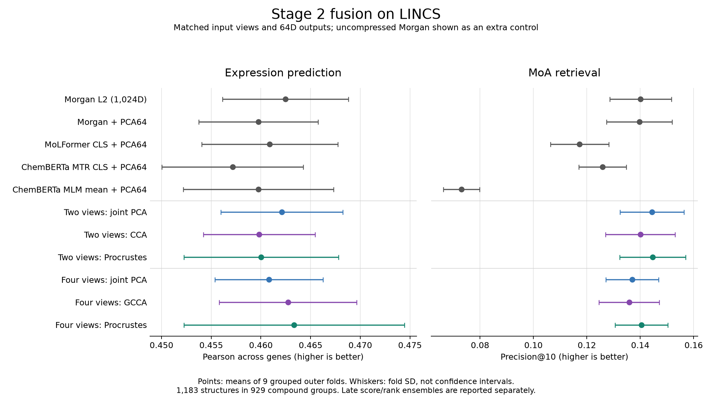

# Stage 2 LINCS fusion benchmark

**The gains are small and task-dependent; the new methods do not consistently outperform the controls.**

This benchmark compares CCA, MAXVAR GCCA and Procrustes against joint PCA on
matched input views and output widths. It reuses the audited Stage 1 cohort,
with all real-data processing and evaluation on Slurm compute nodes.

## Cohort and task

The cohort contains **1,183 canonical structures in 929 compound-name groups**,
with 978-gene targets pooled from 28,730 LINCS Level-5 signatures. Targets average
observed cell lines, doses and times within each structure. This is structure-level
profile prediction, not context-specific response prediction. Related structures
sharing compound names stay together in both outer and inner folds.

The [Stage 1 report](fusion_benchmark_lincs.md) documents exclusions, conflicting
MoLFormer duplicates, the removed ChemBERTa metadata column, and regenerated raw
classical features. Stage 2 uses the identical cohort NPZ. It does not restore
excluded structures or use globally standardized legacy descriptor matrices.

Two comparison sets are prespecified:

- **Pair:** raw Morgan-1024 and MoLFormer CLS; joint PCA, CCA and Procrustes.
- **Four views:** the pair plus ChemBERTa-2 MTR CLS and MLM mean; joint PCA,
  MAXVAR GCCA and Procrustes.

Each fused representation and each single-view PCA control has **64 dimensions**.
An uncompressed L2 Morgan control retains 1,024 dimensions. CCA/GCCA first reduce
each view to 128 PCs. All normalization, centering, PCA and alignment fit within
the relevant training fold. L2 normalization is used throughout; Procrustes uses
Morgan as its explicit reference. View weights are equal. CCA/GCCA use relative
covariance ridge candidates `[0.01, 0.1, 1.0]`.

## Evaluation

Three grouped outer folds repeat with seeds 0, 1 and 2. Regression uses Ridge with
alpha candidates `[0.1, 1, 10, 100, 1000, 10000]`; fusion and Ridge parameters are jointly
selected by three grouped inner folds on negative MSE. Retrieval selects fusion
parameters with three grouped inner folds on precision@10. Queries retrieve only
outer-training references, with exact MoA-label match defining relevance.
Score/rank averaging are additional controls over these **four** raw views.

Every configuration uses the same outer entities and groups. Fold SD describes
variation across nine overlapping training/test experiments; it is not a
confidence interval or a significance test. The top configuration on these
folds is exploratory and does not establish a universal winner.
These outer folds were already inspected during Stage 1; they are not a fresh
final holdout. The broader Ridge grid also differs from Stage 1, so use the
controls rerun here when attributing a gain to a Stage 2 method.

## Results



[Download the figure as PDF](benchmark_results/fusion_stage2_lincs/overview.pdf).

Pearson is measured across the 978 genes for each held-out structure and then averaged.
MSE averages across structures and genes. All values below are means of nine fold scores.

| Configuration | Prediction Pearson ± SD | Prediction MSE | MoA precision@10 ± SD |
| --- | ---: | ---: | ---: |
| Morgan L2 (1,024D) | 0.4625 ± 0.0063 | 0.2662 | 0.1401 ± 0.0116 |
| Morgan + PCA64 | 0.4598 ± 0.0060 | 0.2683 | 0.1396 ± 0.0123 |
| MoLFormer CLS + PCA64 | 0.4609 ± 0.0068 | 0.2698 | 0.1173 ± 0.0109 |
| ChemBERTa-2 MTR CLS + PCA64 | 0.4572 ± 0.0071 | 0.2685 | 0.1259 ± 0.0089 |
| ChemBERTa-2 MLM mean + PCA64 | 0.4598 ± 0.0076 | 0.2713 | 0.0730 ± 0.0068 |
| Two views: joint PCA | 0.4621 ± 0.0061 | 0.2668 | 0.1444 ± 0.0120 |
| Two views: CCA | 0.4598 ± 0.0056 | 0.2676 | 0.1400 ± 0.0130 |
| Two views: Procrustes | 0.4600 ± 0.0078 | 0.2687 | 0.1447 ± 0.0123 |
| Four views: joint PCA | 0.4608 ± 0.0054 | 0.2690 | 0.1370 ± 0.0099 |
| Four views: GCCA | 0.4627 ± 0.0069 | 0.2664 | 0.1359 ± 0.0113 |
| Four views: Procrustes | 0.4633 ± 0.0111 | 0.2683 | 0.1405 ± 0.0099 |

The training-mean response control gives Pearson **0.4498 ± 0.0072** and MSE **0.2751**.
The four-view late controls give precision@10 **0.1418 ± 0.0086** for score averaging and **0.1234 ± 0.0075** for rank averaging.

The observed tradeoffs are:

- **CCA:** lower Pearson and retrieval precision than joint PCA on the same two views.
- **GCCA:** improves four-view PCA prediction (Pearson 0.4627 versus 0.4608; MSE 0.2664 versus 0.2690), but has slightly lower retrieval precision.
- **Procrustes:** four-view fusion has the highest Pearson within this comparison (0.4633), while two-view fusion has the highest retrieval precision (0.1447). The latter exceeds two-view PCA by only 0.00024.
- **Morgan remains competitive:** the uncompressed L2 control retains the lowest prediction MSE (0.2662). Its Pearson differs from the best Stage 2 value by only 0.00087.

**There is no demonstrated universal winner or statistically established improvement here.**
The metric and the input view set matter. In particular, this four-view comparison
does not supersede the eleven-view PCA result in Stage 1.

Both CCA and GCCA selected Ridge alpha 1,000 in all nine prediction fits. Each
selected fusion regularization 1.0 in seven folds and 0.1/0.01 once each.
Retrieval selected different fusion regularization: CCA chose 1.0 in eight
folds, while GCCA chose 0.01 in six. These are task-dependent inner-fold choices.
The fusion ridge search is limited to the three stated candidates; this is not
exhaustive optimization, and several prediction choices lie at its upper boundary.

### Saved numeric outputs

- [Regression fold scores](benchmark_results/fusion_stage2_lincs/regression_folds.csv) and [summary](benchmark_results/fusion_stage2_lincs/regression_summary.csv).
- [Retrieval fold scores](benchmark_results/fusion_stage2_lincs/retrieval_folds.csv) and [summary](benchmark_results/fusion_stage2_lincs/retrieval_summary.csv).
- [Regression configuration](benchmark_results/fusion_stage2_lincs/regression_config.json) and [retrieval configuration](benchmark_results/fusion_stage2_lincs/retrieval_config.json).
- [Integrity audit](benchmark_results/fusion_stage2_lincs/verification.json); [regression execution](benchmark_results/fusion_stage2_lincs/execution_regression.json) and [retrieval execution](benchmark_results/fusion_stage2_lincs/execution_retrieval.json).

## Execution and checks

Run date: 2026-11-09. All real-data model fitting, evaluation, metric audits and
figure generation ran on Slurm compute nodes, using at most four CPUs and 8 GB RAM.

- Expanded tests and executed tutorial: job **42994777**, **68 tests passed**, seven notebook code cells completed without errors.
- Regression: job **42995469**, **99** configuration/fold rows and **39,039** entity-score rows.
- Retrieval: job **42995470**, **117** configuration/fold rows and **46,137** entity-score rows.
- Initial numeric audit: **42995471**; verified figure: **43000793**; clean-source audit: **43000848**.
- All saved primary metrics reaggregate from entity scores; every configuration covers every entity once per seed.
- Outer splits are identical to Stage 1, compound groups do not cross partitions, and 14 imported benchmark source files match the local implementation by SHA-256.
- The audit checks saved outputs and provenance; it does not independently retrain every model. Numerical unit tests separately compare the operators with direct reference calculations.

The small result tables, provenance and figure are included here. The cohort,
full entity scores and split tables remain on the cluster:

```text
/lustre/groups/ml01/workspace/goncalo.pinto/embpy/runs/fusion_stage1_20261109/cohort.npz
/lustre/groups/ml01/workspace/goncalo.pinto/embpy/runs/fusion_stage2_20261109/
```

The source snapshot is under `.job_tmp/fusion_stage2_20261109/code` in the cluster
checkout. An incomplete pilot with the narrower Ridge grid was superseded before
these final runs. No pilot results are included in the tables above.

## Reproduction

See [the method guide](fusion_alignment.md) and
[executed synthetic tutorial](notebooks/08_fusion_alignment.ipynb).

```bash
export EMBPY_SOURCE_ROOT=/path/to/embpy
export EMBPY_PYTHON=/path/to/environment/bin/python
sbatch submission_scripts/run_fusion_alignment_lincs.sbatch \
  --cohort-dir /cluster/path/to/fusion_stage1_20261109 \
  --output-dir /cluster/path/to/fusion_stage2_20261109 \
  --task regression
# Repeat with --task retrieval. The default is three folds and seeds 0, 1, 2.
```

The job writes per-seed checkpoints and combined fold/entity metrics, split
assignments, configuration files, cohort/source hashes and software versions.
Regression's transform cache is temporary and removed after each seed.

To audit the saved run and regenerate its figure on the cluster:

```bash
python -m embpy.scripts.verify_fusion_alignment_lincs \
  --cohort-dir /cluster/path/to/fusion_stage1_20261109 \
  --output-dir /cluster/path/to/fusion_stage2_20261109 \
  --source-root /path/to/embpy/src/embpy --plot
```

The verifier targets this fixed three-seed, three-fold comparison and requires
the Stage 1 split table. Source fingerprint checks ignore macOS archive sidecars,
which are metadata and are never imported as Python modules.
