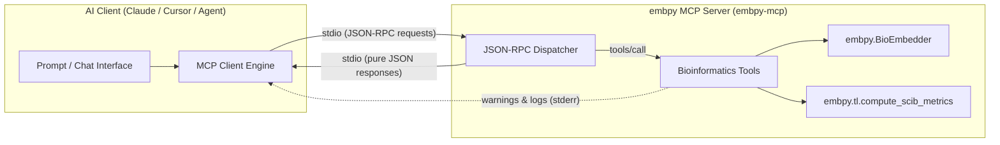

# Model Context Protocol (MCP) Server

`embpy` provides a native [Model Context Protocol (MCP)](https://modelcontextprotocol.io/) server that exposes core bioinformatics and single-cell representation skills directly to AI developer assistants such as **Claude Desktop**, **Cursor**, **Windsurf**, and custom LLM agent pipelines.

Through MCP, an AI assistant can autonomously inspect raw single-cell AnnData datasets, run foundation-model and baseline embeddings via `BioEmbedder`, and evaluate integration and biological conservation quality using `scIB` metrics.

---

## 1. Architecture & Protocol Isolation

MCP communication is established over standard input and output streams (`stdio`) using JSON-RPC 2.0 frames. To prevent stray output or third-party library chatter (such as from `torch`, `scanpy`, or `scib`) from corrupting the JSON-RPC message stream, the `embpy` MCP server enforces strict **stdio isolation**:

- **Diagnostic Logs & Warnings:** Routed exclusively to `sys.stderr`.
- **Library Output Redirection:** Functions executing inside tool calls divert standard output to `sys.stderr`.
- **Pure JSON-RPC Output:** Standard output (`sys.stdout`) receives only valid JSON-RPC protocol frames.
- **Resilient Error Traps:** Tool exceptions (such as missing files, invalid keys, or Out-Of-Memory errors) are intercepted and returned as structured, actionable JSON error payloads rather than terminating the server process.



---

## 2. Installation

Install `embpy` with the optional `[mcp]` extra:

```bash
# From PyPI
pip install "embpy[mcp]"

# From source (editable development install)
pip install -e .[mcp]
```

To install single-cell foundation model backends and `scIB` metrics dependencies alongside MCP:

```bash
pip install -e .[mcp,cpu]      # CPU environment
# or
pip install -e .[mcp,gpu]      # CUDA GPU environment
```

Verify the installation and CLI entrypoint:

```bash
embpy-mcp --help
# or run via module:
python -m embpy.mcp.server
```

---

## 3. Client Configuration

### Claude Desktop

Add `embpy` to your `claude_desktop_config.json`:

=== "macOS / Linux (`~/.config/Claude/claude_desktop_config.json` or `~/Library/Application Support/Claude/claude_desktop_config.json`)"

    ```json
    {
      "mcpServers": {
        "embpy": {
          "command": "/path/to/your/venv/bin/python",
          "args": ["-m", "embpy.mcp.server"],
          "env": {
            "PYTHONUNBUFFERED": "1"
          }
        }
      }
    }
    ```

=== "Windows (`%APPDATA%\Claude\claude_desktop_config.json`)"

    ```json
    {
      "mcpServers": {
        "embpy": {
          "command": "C:\\Users\\<Username>\\AppData\\Local\\Programs\\Python\\Python312\\python.exe",
          "args": ["-m", "embpy.mcp.server"],
          "env": {
            "PYTHONUNBUFFERED": "1"
          }
        }
      }
    }
    ```

> **Note on Windows Paths:** Ensure all backslashes in paths are escaped (`\\`) or use forward slashes (`/`).

---

### Cursor IDE

In Cursor, navigate to **Settings** &rarr; **Features** &rarr; **MCP** &rarr; **Add New MCP Server**, or configure `.cursor/mcp.json` in your workspace:

```json
{
  "mcpServers": {
    "embpy": {
      "command": "python",
      "args": ["-m", "embpy.mcp.server"]
    }
  }
}
```

If you are using a dedicated virtual environment, point `command` directly to the environment's Python executable (e.g., `./venv/bin/python` or `.\\venv\\Scripts\\python.exe`).

---

## 4. Available Tools

The MCP server provides three core tools:

| Tool | Description | Key Inputs |
| :--- | :--- | :--- |
| `inspect_anndata` | Inspects `.h5ad` metadata without reading dense count matrices into memory. | `path`, `max_categories` |
| `embed_cells` | Computes cell embeddings using `BioEmbedder` (e.g., `pca`, `scvi`, `scgpt`, `geneformer`). | `path`, `models`, `batch_size`, `output_path`, `device` |
| `evaluate_scib` | Benchmarks embeddings on bio-conservation and batch-correction metrics. | `path`, `embedding_keys`, `label_key`, `batch_key`, `output_csv` |

### `inspect_anndata`
Reads an AnnData (`.h5ad`) file in backed mode to inspect dataset dimensions, observations, variables, and existing embedding slots.

- **Parameters:**
    - `path` *(str, required)*: Path to the target `.h5ad` file.
    - `max_categories` *(int, default=10)*: Maximum number of category levels to summarize in observation columns.
- **Output:** JSON object containing `n_obs`, `n_vars`, `obs_columns`, `layers`, `obsm_keys`, and observation summary counts.

### `embed_cells`
Wraps `BioEmbedder.embed_cells()` to generate single-cell embeddings.

- **Parameters:**
    - `path` *(str, required)*: Path to the input `.h5ad` dataset.
    - `models` *(list[str] \| str, default="pca")*: Model roster to compute (e.g., `["pca"]`, `["pca", "scvi"]`).
    - `batch_size` *(int, default=32)*: Inference batch size.
    - `output_key` *(str, optional)*: Custom `.obsm` key name for a single model run.
    - `output_path` *(str, optional)*: Filesystem path to save the updated AnnData file with new embeddings.
    - `preprocessing` *(str, default="auto")*: Preprocessing strategy (`"auto"`, `"standard"`, `"raw"`, `"none"`).
    - `device` *(str, default="auto")*: Device target (`"auto"`, `"cpu"`, `"cuda"`).
- **Output:** JSON object containing `n_cells`, `models_computed`, `embedding_keys`, and embedding matrix shapes.

### `evaluate_scib`
Scores representation quality across one or more `.obsm` keys using `scIB` metrics.

- **Parameters:**
    - `path` *(str, required)*: Path to the `.h5ad` dataset containing embeddings in `.obsm`.
    - `embedding_keys` *(list[str] \| str, required)*: Keys in `.obsm` to evaluate (e.g., `["X_pca", "X_scvi"]`).
    - `label_key` *(str, required)*: Column in `adata.obs` holding biological ground-truth labels (e.g., `cell_type`).
    - `batch_key` *(str, optional)*: Column in `adata.obs` holding technical batch annotations.
    - `output_csv` *(str, optional)*: Filesystem path to export the comparison metric table.
- **Output:** JSON object containing `summary` ranking records, `total` composite scores, and individual metric breakdowns (NMI, ARI, ASW label, ASW batch, graph connectivity, iLISI, kBET).

---

## 5. Example AI Assistant Prompts

Here are examples of how to interact with an AI assistant that has `embpy-mcp` enabled:

=== "Dataset Inspection"

    > *"Inspect the dataset located at `data/pbmc3k.h5ad`. What cell types and batch annotations are available, and are there any existing embeddings in `.obsm`?"*

=== "Running Embeddings"

    > *"Compute a 50-component PCA embedding on `data/pbmc3k.h5ad` using `embed_cells`. Save the resulting dataset to `data/pbmc3k_embedded.h5ad`."*

=== "Benchmarking with scIB"

    > *"Evaluate the embeddings `['X_pca', 'X_scvi']` in `data/pbmc3k_embedded.h5ad` against the ground-truth cell type column `cell_type` and batch column `batch`. Export the benchmark table to `reports/scib_evaluation.csv` and summarize the results."*

---

## 6. Troubleshooting & Best Practices

### Windows Path Escaping
On Windows, file paths passed in JSON configurations or LLM prompts must avoid unescaped backslashes:
- **Recommended:** Forward slashes: `C:/Users/name/data/cells.h5ad`
- **Alternative:** Escaped backslashes: `C:\\Users\\name\\data\\cells.h5ad`

### Virtual Environment Python Selection
When configuring Claude Desktop or Cursor, verify that the configured Python executable points to the environment where `embpy[mcp]` was installed:
```bash
# Find virtualenv python path:
# On POSIX:
which python
# On Windows PowerShell:
(Get-Command python).Source
```

### Out-Of-Memory (OOM) Errors
When embedding large single-cell datasets with deep learning backends:
1. Decrease the `batch_size` parameter (e.g., `batch_size=16` or `batch_size=8`).
2. Run on CPU if GPU VRAM is constrained (`device="cpu"`).
3. If memory limits persist, subsample the AnnData object before embedding.
