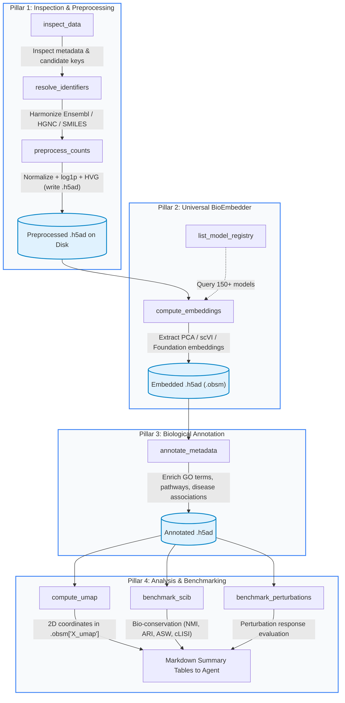

# Autonomous Agentic Bioinformatics: The Universal `embpy` MCP Architecture

Single-cell biology workflows are increasingly dynamic, requiring seamless orchestration across data triage, identifier harmonization, foundation model embedding, external biological knowledge enrichment, and comparative benchmarking. 

The **Model Context Protocol (MCP)** server for `embpy` exposes the entire universal embedding and analytical pipeline directly to AI assistants (**Claude Desktop**, **Cursor**, **Windsurf**, and autonomous agent frameworks) as a reliable, self-correcting state machine.

---

## 1. The Context Window Bottleneck & "Token-Saving" Guardrails

Connecting Large Language Models (LLMs) directly to single-cell genomics presents a critical architectural challenge: **Context Window Exhaustion**.

A typical single-cell dataset with 15,000 cells and 2,000 highly variable genes contains over **30,000,000 numerical matrix entries**. Serializing even a tiny fraction of this raw matrix into an LLM context window crashes the model or exhausts tokens within a single turn.

`embpy` enforces strict **Token-Saving Guardrails**:

1. **Never Return Raw Matrices:** Tool invocations never output high-dimensional count arrays or dense float tensors into the LLM context. Data remains cached in standard `.h5ad` files or persistent disk structures.
2. **Compact Metadata Responses:** Every tool returns a concise JSON envelope containing:
   - Execution status (`success` or `error`)
   - Filesystem destination paths for downstream steps
   - Matrix dimensions and shapes (e.g. `(60, 50)`)
   - Mapping success percentages and sample pairs
   - Formatted Markdown summary tables for metrics that the LLM can interpret effortlessly.
3. **Graceful Error Trapping:** Scanpy, PyTorch, or AnnData exceptions (e.g., shape mismatches, missing observation columns, out-of-memory warnings) are caught and converted into actionable error messages, allowing the AI agent to adjust its parameters autonomously.
4. **Stdio Protocol Isolation:** All runtime diagnostics, C++ stderr logs, and library chatter are strictly redirected to `sys.stderr`, ensuring `sys.stdout` remains pristine JSON-RPC 2.0 frames.

---

## 2. The 4-Pillar Universal State Machine

The `embpy` MCP server organizes biological representation learning into four autonomous pillars:



### Pillar 1: Inspection & Preprocessing
- **`inspect_data`**: Profiles AnnData `.h5ad` files or raw lists, returning cell/gene counts, available `.obs` columns, `.obsm` keys, and whether `.X` is raw counts or log-normalized. Automatically identifies best candidate columns for cell types (`label_key`) and technical batches (`batch_key`).
- **`resolve_identifiers`**: Harmonizes biological vocabularies (e.g. HGNC symbols to Ensembl IDs for Geneformer/scGPT, or chemical names to SMILES). Returns mapping rates without dumping large dictionaries.
- **`preprocess_counts`**: Executes library-size normalization (`sc.pp.normalize_total`), log1p transformation (`sc.pp.log1p`), and highly variable gene (HVG) selection. Saves the preprocessed dataset to disk and returns only the file path and summary metrics.

### Pillar 2: Universal BioEmbedder
- **`list_model_registry`**: Returns the complete catalog of ~150 biological foundation models across single cells, genes, proteins, and molecules, along with compute hardware status (CUDA/MPS/CPU).
- **`compute_embeddings`**: Wraps `BioEmbedder.embed()` to generate representations across models (e.g., `pca`, `scvi`, `scgpt`, `esm2`, `borzoi`). Saves embeddings to `.obsm` (or `.varm`/`.uns`) and returns the new dataset path and array dimensions.

### Pillar 3: Biological Metadata Annotation
- **`annotate_metadata`**: Enriches `.obs` or `.uns` with external biological knowledge (e.g., GO biological processes, KEGG/Reactome pathways, disease mappings, pharmacology) based on entities present. Returns a list of newly added annotation columns.

### Pillar 4: Analysis & Benchmarking
- **`compute_umap`**: Computes neighbor graphs and 2D UMAP coordinates over any chosen embedding representation, storing coordinates under `.obsm['X_umap_<model>']` and reporting array dimensions.
- **`benchmark_scib`**: Wraps `tl.compute_scib_metrics()` to score embeddings on biological conservation (NMI, ARI, ASW label) and batch correction (ASW batch, graph connectivity, cLISI). Returns a concise Markdown table for immediate agent interpretation.
- **`benchmark_perturbations`**: Wraps `tl.run_cell_eval()` across paired or split datasets, scoring differential perturbation responses against reference controls. Returns a concise Markdown summary table.

---

## 3. Quick Start

Install `embpy` with MCP support:

```bash
pip install "embpy[mcp]"
```

Start the MCP server via stdio:

```bash
embpy-mcp
```

Or run via Python module:

```bash
python -m embpy.mcp.server
```

For IDE-specific connection instructions, see [Client Setup Guide](client-setup.md).
