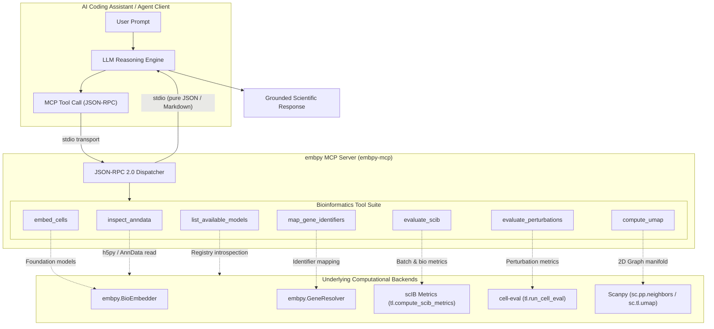

# Agentic MCP Skills & Workflows

Single-cell biology workflows are increasingly dynamic, spanning data triage, gene identifier harmonization, foundation model embedding, integration benchmarking, and perturbation scoring. The **Model Context Protocol (MCP)** server for `embpy` connects AI assistants (such as **Claude Desktop**, **Cursor**, **Windsurf**, and autonomous agents) directly to single-cell foundation models and scverse analytical pipelines.

---

## 1. Why MCP for Single-Cell Biology?

Historically, computational biologists and bioinformaticians spend hours writing boilerplate code to:
- Inspect large `.h5ad` AnnData files to verify cell counts, batch columns, and normalization status.
- Diagnose missing gene identifiers (e.g., reconciling Ensembl gene IDs with HGNC symbols for Geneformer or scGPT).
- Run high-dimensional embedding workflows across multiple foundation models (`pca`, `scvi`, `scgpt`, `geneformer`, `state`).
- Benchmark integration metrics using `scIB` and evaluate perturbation responses with `cell-eval`.

With `embpy`'s native MCP server, an AI assistant becomes an active laboratory collaborator capable of executing real, sandboxed bioinformatics operations via standard tool calling.



---

## 2. Protocol Isolation & Crash Resilience

MCP requires clean, uncorrupted communication over standard I/O (`stdio`). Single-cell libraries like PyTorch, Scanpy, scvi-tools, and scIB frequently print progress bars, diagnostic logs, or CUDA warnings to standard output, which can corrupt the JSON-RPC message framing.

`embpy` enforces strict **stdio isolation and resilience**:

1. **Stdio Redirection:** Standard output from internal library operations is captured and redirected to `sys.stderr`, guaranteeing that `sys.stdout` carries only valid JSON-RPC frames.
2. **Resilient Exception Trapping:** If an operation encounters an out-of-memory (OOM) error, a missing annotation column, or a missing model checkpoint, the tool catches the exception and returns a structured JSON diagnostic payload rather than crashing the server.
3. **JSON Sanitization:** All floating-point numbers (`NaN`, `Inf`, `-Inf`) and NumPy/Pandas types are automatically sanitized to compliant JSON representations.

---

## 3. Quick Start

Install `embpy` with the optional `[mcp]` dependency:

```bash
pip install "embpy[mcp]"
```

Launch the MCP server directly from your terminal:

```bash
embpy-mcp
```

Or invoke the Python module entrypoint:

```bash
python -m embpy.mcp.server
```

---

## 4. MCP Tools Overview

The `embpy` MCP server registers 7 specialized bioinformatics tools:

| Tool | Core Capability | Target Entities |
| :--- | :--- | :--- |
| [`inspect_anndata`](tools-reference.md#1-inspect_anndata) | Inspects `.h5ad` file metadata, cell/gene counts, categorical obs, layers, and raw/normalized status without full memory loading. | AnnData files |
| [`list_available_models`](tools-reference.md#2-list_available_models) | Discovers installed single-cell foundation models, hardware accelerator availability, and optional package extras. | System environment |
| [`map_gene_identifiers`](tools-reference.md#3-map_gene_identifiers) | Maps and validates gene IDs between Ensembl (ENSG...) and HGNC symbols using `embpy.GeneResolver`. | Gene identifiers |
| [`embed_cells`](tools-reference.md#4-embed_cells) | Runs `BioEmbedder.embed_cells()` with configurable model rosters, batch sizes, and devices. | Single-cell datasets |
| [`evaluate_scib`](tools-reference.md#5-evaluate_scib) | Benchmarks embedding biological conservation (NMI, ARI, ASW, cLISI) and batch correction using scIB. | Cell embeddings |
| [`evaluate_perturbations`](tools-reference.md#6-evaluate_perturbations) | Evaluates pairwise perturbation-response prediction metrics using `cell-eval`. | Perturbed single cells |
| [`compute_umap`](tools-reference.md#7-compute_umap) | Computes neighbor graphs and 2D UMAP coordinates on chosen embedding keys. | Latent embeddings |

---

## 5. Explore Next

- 🔧 **[Tools Reference](tools-reference.md):** Complete specification of parameters, options, return types, and schemas for all 7 tools.
- ⚙️ **[Client Setup Guide](client-setup.md):** Ready-to-copy configurations for Claude Desktop, Cursor, Windsurf, and custom agent loops.
- 💬 **[Example Prompts](example-prompts.md):** Tested natural language prompts for driving single-cell workflows with LLM agents.
- 📓 **[Jupyter Tutorial Notebook (`tutorials/05_mcp_agent_workflows.ipynb`)](https://github.com/theislab/embpy/blob/main/tutorials/05_mcp_agent_workflows.ipynb):** Hands-on interactive walkthrough illustrating programmatic tool invocation and simulated agent tool loops.
